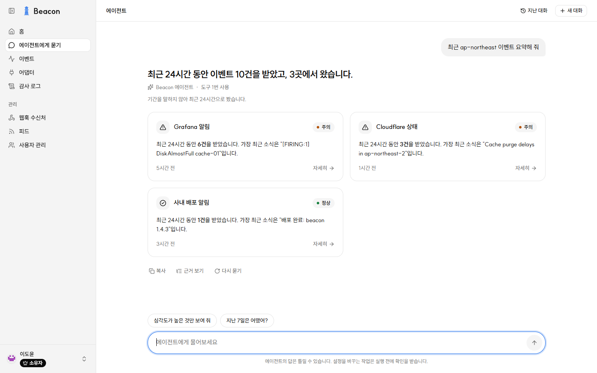
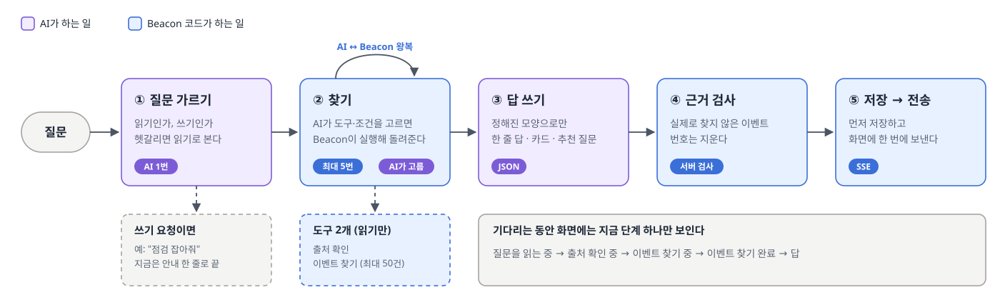
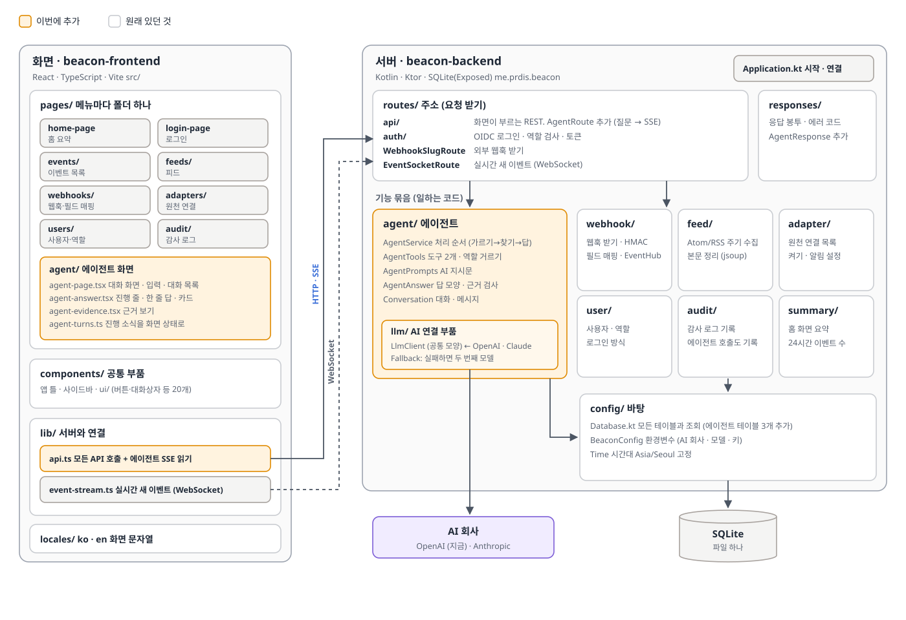
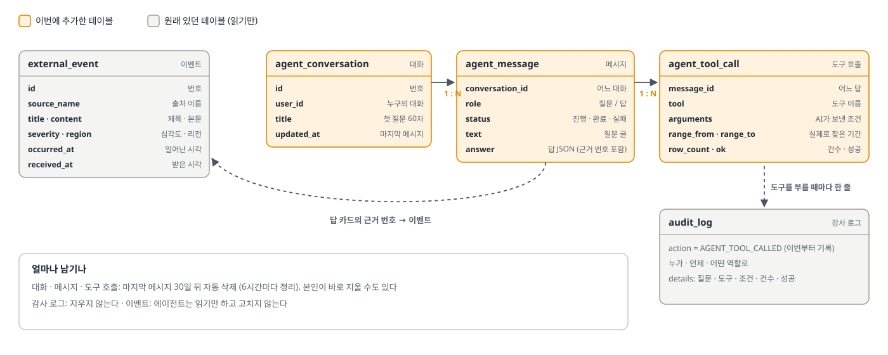
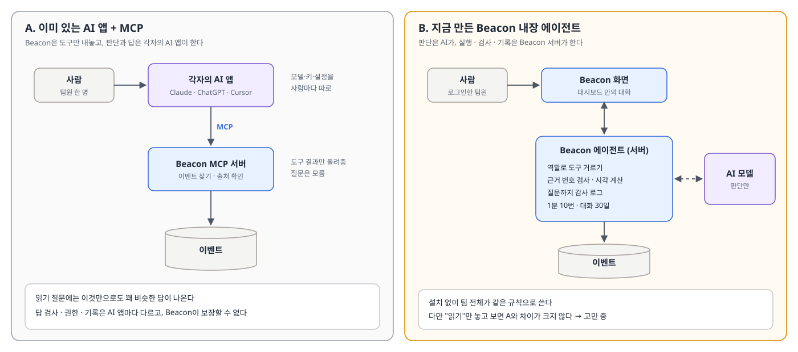

# Beacon AI 에이전트 기능 도입 정리

## 1. 한 줄 요약

- **Beacon**은 웹훅과 피드(Atom/RSS)로 들어오는 여러 도구의 알림(이벤트)을 한곳에 모으는 팀용 대시보드다.
- 이번에 **자연어로 물으면 이벤트를 찾아 답하는 AI 에이전트**를 붙였다. 지금은 읽기만 한다.
- 원칙: **AI는 무엇을 찾을지 고르고, 실제로 찾고 검사하고 기록하는 일은 Beacon 서버가 한다.**

## 2. 시연

[](https://www.youtube.com/watch?v=n3LEvBJPu5Y)



*답 화면. 한 줄 답, 출처별 카드(점 색이 상태), 에이전트가 정한 가정, 추천 질문, "근거 보기".*

## 3. 이번에 만든 것

| 기능 | 내용 |
| --- | --- |
| 질문 가르기 | AI가 읽기인지 쓰기인지 먼저 가른다. 쓰기("점검 잡아줘")는 아직 안내 한 줄로 끝낸다 |
| 읽기 도구 2개 | **출처 확인**(어떤 출처와 값이 있나), **이벤트 찾기**(출처·심각도·리전·낱말·기간, 최신순 최대 50건) |
| 찾기 반복 | AI가 결과를 보고 더 찾을지 정한다. 최대 5번 |
| 정해진 답 모양 | 한 줄 답, 카드 최대 6장, 추천 질문 최대 3개, 가정 최대 3개 (JSON) |
| 근거 검사 | 이번에 실제로 찾지 않은 이벤트 번호는 서버가 지운다. 시각도 서버가 채운다 |
| 진행 표시 | SSE로 "출처 확인 중 → 이벤트 찾기 완료"처럼 지금 단계를 보여 주고, 답은 검사가 끝난 뒤 한 번에 보낸다 |
| 대화 저장 | 대화를 저장해 이어 묻는다(최근 10개 메시지를 AI에 전달). 30일 뒤 자동 삭제, 직접 삭제 가능 |
| 권한 · 기록 · 제한 | 역할로 도구를 거르고, 도구를 부를 때마다 감사 로그에 질문과 함께 남긴다. 1분에 10번까지 |
| AI 회사 교체 | 공통 연결 부품(`LlmClient`)에 OpenAI·Claude 어댑터를 꽂는다. 환경변수로 고르고, 실패하면 두 번째 모델로 한 번 더 |

## 4. 질문 하나가 처리되는 흐름



- 보라색은 AI가, 파란색은 Beacon 코드가 하는 일이다. AI는 기간을 "최근 1시간·24시간·7일·30일" 중에서 고르기만 하고, 실제 시각은 코드가 계산한다.
- 답을 먼저 저장하고 보내므로 브라우저를 닫아도 답은 남는다.

## 5. 코드 구조



**서버는 위에서 아래로 세 층이다.** 요청은 `routes/`(주소)로 들어와 기능 묶음(`agent/`, `webhook/`, `feed/` …)의 함수를 부르고, 기능 묶음은 `config/Database.kt`(모든 테이블과 조회가 모인 파일)를 거쳐 SQLite에 닿는다. 응답 모양과 에러 코드는 `responses/`에 따로 있다.

**화면은 메뉴마다 `pages/` 아래 폴더 하나다.** 서버 호출은 모두 `lib/api.ts`를 거치고, 실시간 새 이벤트는 `lib/event-stream.ts`가 WebSocket으로 받는다.

이번에 추가한 파일

| 위치 | 파일 | 하는 일 | 줄 |
| --- | --- | --- | ---: |
| 서버 `agent/` | `AgentService.kt` | 가르기 → 찾기 → 답 → 검사 → 저장 순서 | 312 |
| | `AgentTools.kt` | 도구 2개 정의, 역할 거르기, 실제 조회 | 234 |
| | `AgentAnswer.kt` | 답 모양, 근거 검사, 길이 자르기 | 113 |
| | `AgentPrompts.kt` | AI 지시문 | 92 |
| | `Conversation.kt` | 대화 · 메시지 모델 | 49 |
| 서버 `agent/llm/` | 6개 파일 | 공통 모양 `LlmClient`, OpenAI · Claude 어댑터, 대체 모델 | 416 |
| 서버 `routes/api/` | `AgentRoute.kt` | 질문 받기, SSE 전송, 대화 목록 · 삭제 | 179 |
| 서버 `responses/` | `AgentResponse.kt` | 화면에 보내는 모양 | 157 |
| 화면 `pages/agent/` | `agent-page.tsx` | 대화 화면 · 입력 · 대화 목록 | 407 |
| | `agent-answer.tsx` | 진행 줄 · 한 줄 답 · 카드 | 227 |
| | `agent-turns.ts` | 진행 소식을 화면 상태로 바꾸기 | 87 |
| | `agent-evidence.tsx` | 근거 보기 | 77 |

이 밖에 `Database.kt`(테이블 3개와 조회), `BeaconConfig.kt`(AI 설정 환경변수), `lib/api.ts`(SSE 읽기), 한국어·영어 문자열을 고쳤다. 합치면 서버 약 2,300줄, 화면 약 1,300줄이 늘었다.

## 6. 데이터



- 에이전트가 **읽는** 것은 원래 있던 `external_event` 하나다. 고치지 않는다.
- 새로 **저장하는** 것은 대화 → 메시지 → 도구 호출, 테이블 3개다. 도구 호출에는 AI가 보낸 조건과 "실제로 찾은 기간"을 함께 남겨 "근거 보기"에 쓴다.

화면이 받는 답은 이런 모양이다(예시, 줄임). AI가 쓰는 것은 `lastAt`을 뺀 나머지이고, `lastAt`은 서버가 근거 이벤트에서 채운다.

```json
{
  "headline": "지금 심각한 장애는 1건입니다",
  "cards": [{ "tone": "CRITICAL", "title": "서버 경보", "status": "1건",
              "body": "api-03 메모리 **92%**", "eventIds": [479], "lastAt": "2026-10-28T00:40:12Z" }],
  "followUps": ["최근 7일로 넓혀서 찾아 줘"],
  "assumptions": ["기간을 말하지 않아 최근 24시간으로 봤습니다"]
}
```

## 7. 실제 AI로 시험한 결과

OpenAI gpt-5.4-mini로 질문 8개를 물어 **모두 맞게 답했고, 한 답에 길어야 10초**였다(8개 합쳐 AI 호출 28번). 자동 시험 23개는 AI를 가짜(`FakeLlmClient`)로 바꿔 돌리며 모두 통과했다(10-28).

시험과 첫 실사용에서 고친 것

- 도구를 보낼 때 모델의 추론 설정을 꺼야 요청이 통과했다.
- AI가 "incident" 같은 말을 검색어에 넣어 0건이 나오면, "검색어를 빼면 N건 있다"는 힌트를 돌려줘 스스로 다시 찾게 했다.
- 영어로 물어도 한국어로 답하던 것 → 질문의 언어로 답한다.
- 추천 질문이 AI의 말투("만들어 드릴까요?")로 나오던 것 → 사용자가 누를 문장("최근 7일로 넓혀서 찾아 줘")으로 바꿨다.
- 진행 줄에 완료가 쌓이던 것 → 지금 단계 하나만 보인다. 대화 삭제와 감사 로그의 질문 기록도 이때 더했다.

## 8. 고민 중: "이미 있는 AI 에이전트에 MCP만 붙이면 되지 않나?"



**솔직한 지금 판단: 읽기만 놓고 보면 차이가 크지 않다.** Claude나 ChatGPT 같은 AI 앱에 Beacon의 도구 두 개를 MCP로 붙이거나 "Beacon API로 검색해 봐"라고 시키면, 도구를 골라 여러 번 찾고 요약하는 일은 그쪽도 비슷하게 한다. 이번 구현의 상당 부분은 이미 있는 에이전트가 하는 일을 다시 만든 셈이다.

지금 만든 것 중 A(AI 앱 + MCP)로는 Beacon이 보장하기 어려운 것

| | A. AI 앱 + MCP | B. Beacon 내장 |
| --- | --- | --- |
| 답의 근거 | AI 앱이 쓴 답을 Beacon이 볼 수 없다 | 찾지 않은 근거는 서버가 지운다 |
| 기록 | MCP 서버는 도구 호출만 안다. 무엇을 물었는지는 모른다 | 질문 · 도구 · 조건 · 결과를 감사 로그에 남긴다 |
| 쓰는 사람 | 팀원마다 앱 · 모델 · 키를 따로 설정 | 로그인만 하면 팀 전체가 같은 규칙으로 |
| 비용 | 사람마다 따로 | 한 곳에서 한도와 제한 |

다만 이것들은 대부분 **안전장치**이지, "그래서 더 잘 답한다"는 차별점은 아니다. 그래서 차별점을 만들 방향을 생각하고 있다. 아직 정하지 않은 후보들이다.

## 9. 다음 단계

- 추가 어댑터 도입 고려 및 UI/UX 개선, 프로덕션에 올릴 준비.
- Claude Haiku로 실제 호출을 확인하고 GPT-5.4 mini와 비교한다.
- 차별점 후보를 정한다.
